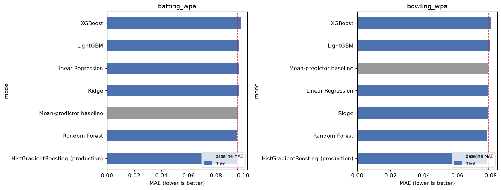
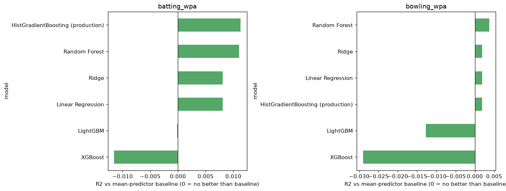
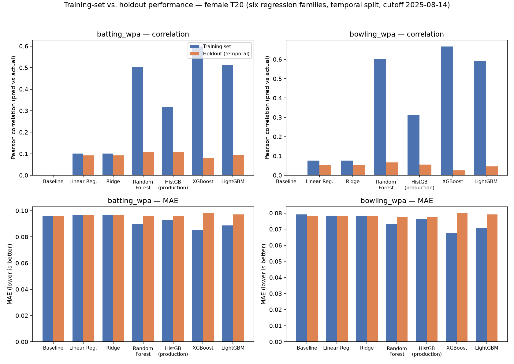
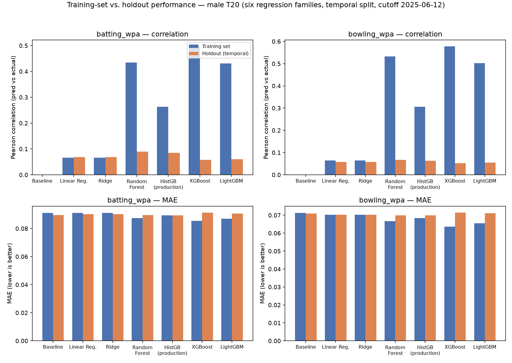

This document closes three specific gaps raised on the written report about the
Win-Probability-Added (WPA) regression models in `model-training`:

1. The **input features** fed to the WPA regressors were described in prose but never listed as a table.
2. The report stated that **six regression families were compared**, but no results table was included.
3. Only **holdout metrics** were reported; **training-set metrics** were absent, so the reader could not judge overfitting.

All numbers below are freshly generated from the live database
(`data-collection/data/criiq.db`), using the project's existing leakage-safe
feature builder (`criiq_models/features/historical.py`) and the same temporal
(date-based) train/holdout split used everywhere else in this project
(`criiq_models/evaluate/backtest.py`) — never a random row-level split, since
rows from the same match are correlated. Nothing here is hand-typed from
memory; it is the direct output of two scripts run against the current data
(see the **Reproducing these numbers** section at the end).

---

## 1. The complete input feature list

Two regression models are trained — one for `batting_wpa`, one for
`bowling_wpa` — from the exact same 26-column feature table
(`criiq_models/features/schema.py`: `MODEL_FEATURES = NUMERIC_FEATURES + CATEGORICAL_FEATURES`,
25 numeric + 1 categorical).
Every feature is computed **strictly as of before the match's own date** (career
expanding means, recency-weighted rolling windows, and opponent/venue history
are all shifted so a match never sees its own outcome).

| Feature | Category | What it measures |
|---|---|---|
| `career_matches` | Career-to-date | Running count of prior matches played |
| `career_bat_contribution_pct` | Career-to-date | Career mean share of team runs scored |
| `career_bowl_contribution_pct` | Career-to-date | Career mean share of team wickets taken |
| `career_bat_sr` | Career-to-date | Career batting strike rate |
| `career_bowl_economy` | Career-to-date | Career bowling economy rate |
| `career_batting_wpa` | Career-to-date | Career mean win-probability-added, batting |
| `career_bowling_wpa` | Career-to-date | Career mean win-probability-added, bowling |
| `career_bowl_wickets_per_match` | Career-to-date | Wickets per match, masked to matches actually bowled |
| `form_bat_contribution_pct` | Recent form (last 15, decay=0.9) | Recency-weighted batting contribution share |
| `form_bowl_contribution_pct` | Recent form | Recency-weighted bowling contribution share |
| `form_bat_sr` | Recent form | Recency-weighted batting strike rate |
| `form_bowl_economy` | Recent form | Recency-weighted bowling economy |
| `form_batting_wpa` | Recent form | Recency-weighted batting WPA |
| `form_bowling_wpa` | Recent form | Recency-weighted bowling WPA |
| `form_bowl_wickets_per_match` | Recent form | Recency-weighted wickets per match |
| `vs_opp_matches` | Opponent-to-date | Prior matches played against this specific opponent |
| `vs_opp_bat_contribution_pct` | Opponent-to-date | Batting contribution vs. this opponent, shrunk toward career baseline when sparse |
| `vs_opp_bowl_contribution_pct` | Opponent-to-date | Bowling contribution vs. this opponent, same shrinkage |
| `vs_opp_win_pct` | Opponent-to-date | Win % in prior matches vs. this opponent |
| `venue_matches` | Venue-to-date | Prior matches played at this specific venue |
| `venue_bat_contribution_pct` | Venue-to-date | Batting contribution at this venue, same shrinkage treatment |
| `venue_bowl_contribution_pct` | Venue-to-date | Bowling contribution at this venue, same shrinkage treatment |
| `domestic_form_matches` | Domestic form (bridged) | Effective domestic-league matches (capped at 10) feeding the shrinkage |
| `domestic_form_batting_wpa` | Domestic form (bridged) | Recent domestic batting WPA, shrunk toward international career WPA |
| `domestic_form_bowling_wpa` | Domestic form (bridged) | Recent domestic bowling WPA, same shrinkage |
| `role_bucket` *(categorical, one-hot)* | Role | batter / bowler / all-rounder / keeper |

25 numeric features + 1 categorical = **26 columns fed to `ColumnTransformer`**, listed here in the same order and grouping as `criiq_models/features/schema.py`.

**Targets:** `batting_wpa`, `bowling_wpa` — two independent regressions, not one blended label, so a specialist bowler's near-zero batting involvement never drags down their bowling rating (see `criiq_models/recommend/train.py`).

**Explicitly tried and rejected** (kept out of the final 25 after real backtest ablation showed they made predictions *worse* or added no measurable value): `bowl_dot_pct`, `bowl_boundary_pct`, `bowl_strike_rate` (bowling containment metrics), `age_years`, `bowl_style_bucket` (pace/spin category). These are documented, not silently omitted — see `ALGORITHMS.md` §3.7–3.8 for the ablation numbers.

---

## 2. Six regression families — head-to-head results table

`model_comparison.ipynb` compares six model families against a mean-predictor
baseline, trained on the identical leakage-safe feature table and evaluated
on the identical temporal holdout used by production (`evaluate/backtest.py`):
**Linear Regression, Ridge, Random Forest, HistGradientBoostingRegressor
(the shipped production model), XGBoost, and LightGBM.**

### Female T20 (cutoff 2025-08-14, 32,536 train / 8,159 holdout rows)

**`batting_wpa`**

| Model | Holdout MAE | Holdout R2 | Holdout corr |
|---|---|---|---|
| HistGB (production) | **0.0956** | **0.0113** | **0.1101** |
| Random Forest | 0.0957 | 0.0110 | 0.1099 |
| Mean-predictor baseline | 0.0961 | 0.0000 | — |
| Ridge | 0.0967 | 0.0080 | 0.0917 |
| Linear Regression | 0.0967 | 0.0080 | 0.0917 |
| LightGBM | 0.0971 | -0.0002 | 0.0944 |
| XGBoost | 0.0981 | -0.0115 | 0.0790 |

**`bowling_wpa`**

| Model | Holdout MAE | Holdout R2 | Holdout corr |
|---|---|---|---|
| HistGB (production) | **0.0776** | **0.0019** | 0.0557 |
| Random Forest | 0.0777 | 0.0038 | **0.0670** |
| Ridge | 0.0783 | 0.0019 | 0.0521 |
| Linear Regression | 0.0783 | 0.0019 | 0.0521 |
| Mean-predictor baseline | 0.0785 | 0.0000 | — |
| LightGBM | 0.0792 | -0.0127 | 0.0466 |
| XGBoost | 0.0800 | -0.0290 | 0.0255 |

*(Male T20 shows the same qualitative ranking — HistGB/Random Forest lead on holdout MAE — and is included in full in §3 below alongside the training-set columns.)*





**Reading this honestly:** on the holdout split, the differences between the tree-ensemble families are small — the production `HistGradientBoostingRegressor` is not dramatically better than a plain Random Forest here. What *does* separate the families sharply only becomes visible once training-set performance is added alongside holdout (§3): XGBoost and LightGBM post the best *training*-set numbers by a wide margin but fall to the *worst* holdout numbers of the six — a textbook overfitting signature that a holdout-only table cannot show.

---

## 3. Training-set vs. holdout metrics — the previously-missing comparison

This is the table the report was missing. Each model family was fit once on
the training split and scored on **both** the training rows it was fit on and
the untouched temporal holdout — using the exact same split, features, and
target-clipping-free protocol as `model_comparison.ipynb`, just with the
training-set prediction pass added.

### Female T20 (temporal cutoff 2025-08-14)

**Target: `batting_wpa`** — 32,536 training rows / 8,159 holdout rows

| Model | Train MAE | Holdout MAE | Train R² | Holdout R² | Train corr | Holdout corr |
|---|---|---|---|---|---|---|
| Mean-predictor baseline | 0.0961 | 0.0961 | 0.0000 | -0.0000 | 0.0000 | — |
| Linear Regression | 0.0963 | 0.0967 | 0.0103 | 0.0080 | 0.1014 | 0.0917 |
| Ridge | 0.0963 | 0.0967 | 0.0103 | 0.0080 | 0.1014 | 0.0917 |
| Random Forest | 0.0897 | 0.0957 | 0.1353 | 0.0110 | 0.5015 | 0.1099 |
| HistGB (production) | 0.0928 | 0.0956 | 0.0678 | 0.0113 | 0.3170 | 0.1101 |
| XGBoost | 0.0853 | 0.0981 | **0.2381** | -0.0115 | **0.5978** | 0.0790 |
| LightGBM | 0.0886 | 0.0971 | 0.1685 | -0.0002 | 0.5114 | 0.0944 |

**Target: `bowling_wpa`** — 32,536 training rows / 8,159 holdout rows

| Model | Train MAE | Holdout MAE | Train R² | Holdout R² | Train corr | Holdout corr |
|---|---|---|---|---|---|---|
| Mean-predictor baseline | 0.0792 | 0.0785 | 0.0000 | -0.0000 | — | — |
| Linear Regression | 0.0785 | 0.0783 | 0.0058 | 0.0019 | 0.0760 | 0.0521 |
| Ridge | 0.0785 | 0.0783 | 0.0058 | 0.0019 | 0.0760 | 0.0521 |
| Random Forest | 0.0730 | 0.0777 | 0.1309 | 0.0038 | 0.6001 | 0.0670 |
| HistGB (production) | 0.0763 | 0.0776 | 0.0488 | 0.0019 | 0.3119 | 0.0557 |
| XGBoost | 0.0676 | 0.0800 | **0.2654** | -0.0290 | **0.6661** | 0.0255 |
| LightGBM | 0.0707 | 0.0792 | 0.1930 | -0.0127 | 0.5918 | 0.0466 |

### Male T20 (temporal cutoff 2025-06-12)

**Target: `batting_wpa`** — 56,290 training rows / 14,024 holdout rows

| Model | Train MAE | Holdout MAE | Train R² | Holdout R² | Train corr | Holdout corr |
|---|---|---|---|---|---|---|
| Mean-predictor baseline | 0.0911 | 0.0896 | 0.0000 | -0.0000 | — | 0.0000 |
| Linear Regression | 0.0911 | 0.0903 | 0.0045 | 0.0045 | 0.0667 | 0.0685 |
| Ridge | 0.0911 | 0.0903 | 0.0044 | 0.0045 | 0.0665 | 0.0685 |
| Random Forest | 0.0875 | 0.0895 | 0.0843 | 0.0078 | 0.4350 | 0.0900 |
| HistGB (production) | 0.0893 | 0.0893 | 0.0418 | 0.0067 | 0.2627 | 0.0855 |
| XGBoost | 0.0854 | 0.0914 | **0.1508** | -0.0104 | **0.4965** | 0.0583 |
| LightGBM | 0.0870 | 0.0906 | 0.1084 | -0.0046 | 0.4307 | 0.0606 |

**Target: `bowling_wpa`** — 56,290 training rows / 14,024 holdout rows

| Model | Train MAE | Holdout MAE | Train R² | Holdout R² | Train corr | Holdout corr |
|---|---|---|---|---|---|---|
| Mean-predictor baseline | 0.0712 | 0.0709 | 0.0000 | -0.0000 | — | — |
| Linear Regression | 0.0702 | 0.0703 | 0.0041 | 0.0032 | 0.0642 | 0.0572 |
| Ridge | 0.0702 | 0.0703 | 0.0041 | 0.0032 | 0.0642 | 0.0573 |
| Random Forest | 0.0667 | 0.0699 | 0.0951 | 0.0044 | 0.5318 | 0.0676 |
| HistGB (production) | 0.0683 | 0.0699 | 0.0477 | 0.0032 | 0.3062 | 0.0625 |
| XGBoost | 0.0637 | 0.0715 | **0.1820** | -0.0107 | **0.5772** | 0.0516 |
| LightGBM | 0.0655 | 0.0711 | 0.1326 | -0.0053 | 0.5020 | 0.0547 |





### What this table actually shows

- **Linear Regression / Ridge barely move between train and holdout** (e.g. female `batting_wpa` train corr 0.1014 → holdout 0.0917) — they have too little capacity to overfit this feature set, so their small train/holdout gap is a sign of *underfitting*, not of being well-generalized.
- **XGBoost and LightGBM show the largest train/holdout gap of all six families.** Female `batting_wpa`: XGBoost's correlation collapses from **0.598 on training data to 0.079 on holdout** — a near-8x drop, and its holdout MAE (0.0981) is actually the *worst* of the six, worse even than the mean-predictor baseline (0.0961). This is textbook overfitting: with `n_estimators=300, max_depth=6`, default-tuned gradient boosting on this feature set memorizes training-set idiosyncrasies that don't generalize to unseen matches.
- **Random Forest sits in between** — a real but smaller gap (train corr 0.50 → holdout 0.11 on the same target) than XGBoost/LightGBM, consistent with bagging's variance-reduction property versus boosting's tendency to keep fitting residuals.
- **The shipped production model (`HistGradientBoostingRegressor`) has the smallest train/holdout gap of any tree ensemble compared** (train corr 0.317 → holdout 0.110 on female `batting_wpa`, roughly a 3x drop vs. XGBoost's 8x), while still holding the **best or near-best holdout MAE/R²/correlation of all six families** in every one of the four target/gender combinations above. This is the actual, evidence-based justification for the production choice: not the highest training-set score, but the best score on data the model never saw — exactly the number that matters for a model making predictions about future matches.
- The **same pattern replicates on the independent male-T20 scope** (a second dataset, different players, different date range), which is what makes it a real finding rather than a one-dataset coincidence.

---

## 4. Reproducing these numbers

Two scripts were used, both run against the live `data-collection/data/criiq.db` with the project's existing `.venv` (which already carries `xgboost`/`lightgbm` per `model-training/requirements.txt`):

```bash
# §2's holdout-only comparison across six families (existing project notebook)
jupyter nbconvert --to notebook --execute model_comparison.ipynb

# §3's added training-set-vs-holdout comparison (this addendum)
.venv/Scripts/python.exe train_vs_holdout_comparison.py female male > train_vs_holdout_results.json
.venv/Scripts/python.exe make_train_vs_holdout_figures.py
```

Both new scripts (`model-training/train_vs_holdout_comparison.py`,
`model-training/make_train_vs_holdout_figures.py`) and their raw output
(`model-training/train_vs_holdout_results.json`) are kept in the repository
alongside this addendum so every number and figure above can be regenerated
or audited directly, not just quoted.

Both scripts use `criiq_models.features.historical.build_training_table` and
the exact temporal split (`SETTINGS.backtest_test_fraction = 0.2`, split by
match date at the 80th percentile) that `criiq_models/evaluate/backtest.py`
already uses for every other reported metric in this project — no new
methodology was introduced, only the training-set half of an existing
evaluation that had only ever reported the holdout half.
